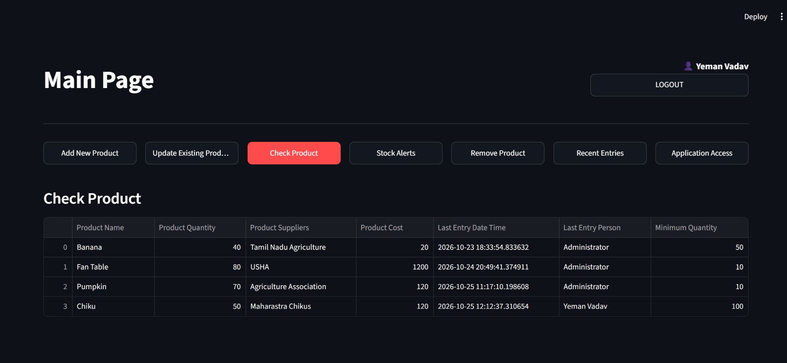

# Python Streamlit Inventory Management System

A secure, lightweight, and modular **Inventory Management System** built with **Python**, **Streamlit**, and **SQLite**. This application features user authentication, real-time inventory tracking, transaction logging, low-stock alerts, and a clean multi-page dashboard UI.

 *(Replace this link with your actual screenshot or GIF)*

---

## 🚀 Features

* **Secure Authentication:** User login with credential validation stored safely in a relational SQLite database.
* **Robust Database Management:** Custom context manager ensuring connection safety with automatic rollbacks on errors and clean commits.
* **Inventory & Transaction Tracking:** Full CRUD operations for products, automated stock updates, and complete transaction log history ordered by timestamp.
* **Low-Stock Alerts:** Real-time monitoring to catch items falling below minimum quantity thresholds.
* **Interactive Dashboard UI:** Built using **Streamlit** with state-managed routing for a seamless multi-page experience.

---

## 📂 Project Architecture

The project follows a clean separation of concerns, isolating database logic from the presentation interface:

```text
Inventory Management System/
│
├── Databases/
│   ├── Context_Manager.py
│   ├── Database_Manager.py
│   └── Inventory_Databases_Creation.py
│
├── Interfaces/
│   ├── Login_Page.py
│   └── Main_Page.py
│
├── inventory.db
└── main.py
```

---

## 🛠️ Tech Stack

* **Language:** Python 3.x
* **UI Framework:** Streamlit
* **Database:** SQLite3
* **Data Processing:** Pandas

---

## ⚙️ Installation and Setup

### 1. Clone the Repository
```bash
git clone https://github.com/YOUR_USERNAME/python-streamlit-inventory-management.git
cd python-streamlit-inventory-management
```

### 2. Create and Activate a Virtual Environment
```bash
python -m venv myenv

# On Windows:
myenv\Scripts\activate

# On macOS/Linux:
source myenv/bin/activate
```

### 3. Install Dependencies
```bash
pip install streamlit pandas
```

### 4. Initialize the Database
Run the database creation script to set up `inventory.db` and the required relational tables (`Access_Table`, `Invertory_table`, and `Transaction_table`):
```bash
python Databases/Inventory_Databases_Creation.py
```

### 5. Run the Application
Launch the Streamlit app using the main entry point:
```bash
streamlit run main.py
```

---

## 📊 Database Schema Overview

* **`Access_Table`**: Manages user credentials, full names, usernames, passwords, and user creation dates.
* **`Invertory_table`**: Stores current stock details, supplier names, product costs, last entry timestamps, and minimum quantity warnings with foreign key constraints linked to user access.
* **`Transaction_table`**: Records historical log entries of every stock modification or addition linked to system users.

---

## 🤝 Contributing

Contributions, issues, and feature requests are welcome! Feel free to check the [issues page](https://github.com/Rahulkatiyarlearner/python-inventory-management/issues).

---

## 📝 License

This project is open-source and available under the [MIT License](LICENSE).
